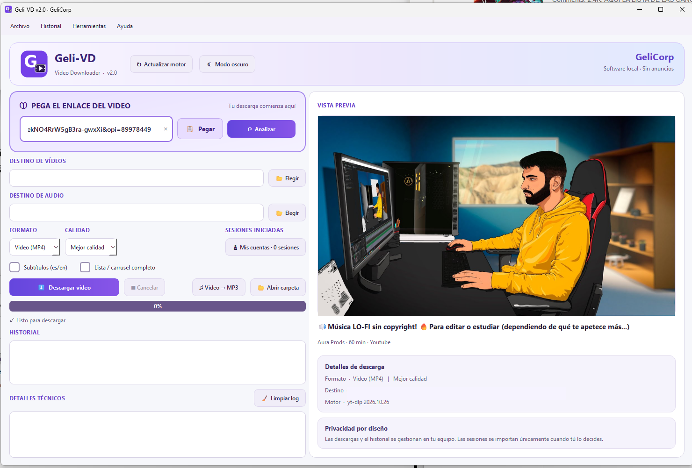

<div align="center">


# Geli-VD — Descargador de videos y audio

**Pega, descarga, listo.**
Descarga videos y audio de sitios compatibles. Gratis y sin anuncios. Parte del ecosistema **Geli**.

[**⬇ Descargar para Windows 10/11 — recomendado (v2.0.0 · 96 MB)**](https://github.com/GeliOSCorp/Geli-VD/releases/download/v2.0.0/Geli-VD-2.0.0-Setup-Windows.exe)

[Windows portable](https://github.com/GeliOSCorp/Geli-VD/releases/download/v2.0.0/Geli-VD-2.0.0-Portable-Windows.zip) · [macOS / Linux (código fuente)](#macos--linux-versión-python) · [Todas las versiones](https://github.com/GeliOSCorp/Geli-VD/releases)

[](https://github.com/GeliOSCorp/Geli-VD/releases/latest)
[](LICENSE)

**Windows:** instalador y portable · **macOS / Linux:** código fuente

Contenido protegido con DRM no compatible.

</div>

<p align="center"></p>

---

## ¿Qué es?

Geli-VD es una app de escritorio para descargar videos y audio pegando un enlace.
Funciona con YouTube, Dailymotion, Vimeo, TikTok, Instagram, Facebook y
[cientos de sitios más](https://github.com/yt-dlp/yt-dlp/blob/master/supportedsites.md).

- **Vista previa** automática: portada, duración y calidades (480p, 720p, 1080p…).
- **Video MP4**, **Audio MP3** o **M4A**, listas y carruseles completos, subtítulos.
- **Historial** de descargas (se puede borrar o desactivar).
- **⟳ Actualizar motor**: cuando un sitio cambia y deja de descargar, se actualiza con
  un clic, **sin reinstalar** la app.
- **Iniciar sesión** para videos que la piden (YouTube "no eres un bot", Instagram…):
  la sesión se guarda localmente y caduca tras 30 días sin uso. Consulta los detalles de
  protección en [Privacidad](#privacidad).
- Tema claro u oscuro según tu sistema.
- **Sin anuncios.** Descargas, historial y preferencias se gestionan en tu equipo.

---

## Descargar e instalar

| Opción | Descarga | Tamaño aproximado | Requisitos |
|---|---|---|---|
| **Windows 10/11 — recomendado** | [Instalador .exe](https://github.com/GeliOSCorp/Geli-VD/releases/download/v2.0.0/Geli-VD-2.0.0-Setup-Windows.exe) | 96 MB | No necesitas instalar Python por separado. |
| Windows — sin instalación | [Portable .zip](https://github.com/GeliOSCorp/Geli-VD/releases/download/v2.0.0/Geli-VD-2.0.0-Portable-Windows.zip) | 130 MB | Extrae todo el ZIP y abre `Geli-VD.exe` desde la carpeta extraída. |
| macOS / Linux — código fuente | [Código multiplataforma](https://github.com/GeliOSCorp/Geli-VD/blob/main/multiplataforma/Geli-VD-2.0/README.md) | — | Python 3.11–3.13, FFmpeg y dependencias de Qt. |

Los tamaños son aproximados y corresponden a los paquetes publicados en la release v2.0.0. Para macOS y Linux se publica el código fuente multiplataforma; el paquete ejecutable de esta release es para Windows.

**¿Cuál elijo?** Si usas Windows y quieres empezar, elige el instalador.
Si prefieres usarlo sin instalar, elige el portable. En macOS o Linux, sigue las instrucciones del código fuente multiplataforma.
Los archivos **Source code** de GitHub contienen el código del repositorio; para usar la app,
elige uno de los paquetes anteriores.

### Windows: instalar o usar el portable

**Instalador (recomendado):**
1. [Descarga el instalador de Geli-VD 2.0.0](https://github.com/GeliOSCorp/Geli-VD/releases/download/v2.0.0/Geli-VD-2.0.0-Setup-Windows.exe).
2. Abre `Geli-VD-2.0.0-Setup-Windows.exe` y sigue el asistente. No pide permisos de administrador.
3. Abre Geli-VD desde el acceso directo creado por el instalador.

**Portable:** [descarga el ZIP](https://github.com/GeliOSCorp/Geli-VD/releases/download/v2.0.0/Geli-VD-2.0.0-Portable-Windows.zip), haz clic derecho → **Extraer todo**
y abre `Geli-VD.exe` dentro de la carpeta extraída. Conserva juntos los archivos del paquete;
no ejecutes el programa desde dentro del ZIP.

**Aviso de Windows:** el ejecutable aún no está firmado digitalmente y Windows puede mostrar
«Windows protegió su PC». Verifica que lo descargaste de esta release oficial.
Si decides continuar, selecciona **Más información → Ejecutar de todas formas**.
No es necesario desactivar el antivirus.

**Actualizar el instalador:** instala la versión nueva encima; se conservan el historial
y las preferencias.

### macOS / Linux: ejecutar desde el código fuente

La release 2.0.0 no incluye un paquete precompilado para macOS o Linux. Revisa los requisitos y los pasos de ejecución en el [README multiplataforma](multiplataforma/Geli-VD-2.0/README.md); se requiere Python 3.11–3.13, FFmpeg y acceso a Internet para instalar dependencias.

---

### Tu primera descarga

1. Pega el enlace de un video compatible.
2. Elige el formato (MP4, MP3 o M4A), la calidad y la carpeta de destino.
3. Pulsa **Descargar**. Algunos sitios o videos requieren iniciar sesión.

---

## Problemas comunes

| Mensaje | Solución |
|---|---|
| "Sign in to confirm you're not a bot" | En **Cookies de** elige **Geli (mi sesión)** e inicia sesión en tu cuenta. |
| Windows: error de cookies de Chrome/Edge | Chrome y Edge protegen sus cookies en Windows. Usa **Geli (mi sesión)** o Firefox. |
| Un sitio que funcionaba dejó de descargar | Pulsa **⟳ Actualizar motor**. |
| Otro problema | Abre un [Issue](https://github.com/GeliOSCorp/Geli-VD/issues) con una captura del mensaje. |

---

## Uso responsable

Geli-VD es una herramienta. Descarga solo contenido **propio, de libre uso o con permiso de
su autor**, respetando las condiciones de cada sitio y los derechos de autor. Los videos con
DRM no se pueden descargar.

## Privacidad

Geli-VD procesa las descargas en tu equipo, sin un servidor propio que las intermedie.
El historial y las preferencias se guardan localmente. La app se conecta a los sitios de los
videos y sus servicios asociados; también consulta PyPI para comprobar actualizaciones del
motor y descarga dependencias cuando corresponde.

Las cookies de sesión se guardan localmente y no se cifran en esta versión. Trátalas como credenciales: no compartas la carpeta de datos ni subas cookies o perfiles a GitHub. Geli-VD no copia cookies del navegador personal.
Puedes borrar los datos desde **Historial → Borrar todos los datos de la app**.

---

## Próximamente

Android está previsto; esta release no incluye una aplicación Android.

[](https://github.com/GeliOSCorp/Geli-VD/releases)

## Para desarrolladores

```
multiplataforma/Geli-VD-2.0/
├── main.py                aplicación Python/PySide6
├── core/                  descarga, motores, sesiones y almacenamiento
├── ui/                    interfaz y temas
└── iniciar_*              lanzadores para Windows, macOS y Linux
```

Para ejecutarla desde el código, consulta [README de la versión multiplataforma](multiplataforma/Geli-VD-2.0/README.md). Las sugerencias y mejoras son bienvenidas vía Issues y Pull Requests.

## Licencia

Geli-VD se distribuye bajo la licencia [**GPL-3.0**](LICENSE): puedes usarlo, estudiarlo,
modificarlo y compartirlo; si distribuyes una versión modificada, debes publicar su código
bajo la misma licencia.

El nombre **Geli**, **Geli-VD** y su logo son de su autor. Si haces tu propia versión,
usa otro nombre y logo.

## Créditos

Construido sobre [yt-dlp](https://github.com/yt-dlp/yt-dlp) (Unlicense),
[FFmpeg](https://ffmpeg.org) (LGPL/GPL), [Deno](https://deno.com) (MIT),
[Pillow](https://python-pillow.org) (MIT-CMU) y
[Playwright](https://playwright.dev) (Apache-2.0).
